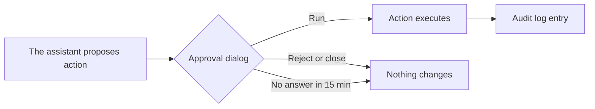

# AI Assistant for OIE — User Manual

Version 2.0.2 · November 2026

The AI Assistant (version 2.0.2) puts an AI chat inside the Open Integration Engine Administrator and web administrator. It works with Claude (Anthropic), OpenAI, Mistral or a local model behind an OpenAI-compatible API. It reads channels, messages, logs and scripts, and it changes nothing without your approval.

> **Unofficial plugin.** This is a community-built plugin. It is not affiliated with, endorsed by or supported by Anthropic. Claude and Anthropic are trademarks of Anthropic, PBC.
>
> **Your responsibility.** Each organization that installs the plugin is responsible for its own use of it: the legal basis and the data processing agreement with Anthropic for any patient data it sends, and the changes its users approve in OIE. The plugin is provided as is, without warranty (Mozilla Public License 2.0).

## Contents

- [Overview](#overview)
- [Requirements](#requirements)
- [Installation and upgrade](#installation-and-upgrade)
- [First-time setup](#first-time-setup)
- [Using the Administrator (Swing) client](#using-the-administrator-swing-client)
- [Using the web administrator](#using-the-web-administrator)
- [What the assistant can read](#what-the-assistant-can-read)
- [Actions and approval](#actions-and-approval)
- [Privacy and masking](#privacy-and-masking)
- [Permissions](#permissions)
- [Usage and costs](#usage-and-costs)
- [No internet and proxies](#no-internet-and-proxies)
- [Troubleshooting](#troubleshooting)
- [Known limitations](#known-limitations)

## Overview

Ask the assistant a question in plain language and it looks up the answer on your OIE server itself. Typical questions:

- "Which channels have errors, and why?"
- "Explain why this message was filtered."
- "What does the transformer in this channel do?"
- "Is this code template used anywhere?"

The assistant reads through built-in tools (see *What the assistant can read*). It can also propose actions, such as redeploying a channel or fixing a script. Those run only after you click *Run*.

The assistant is available in two places, and both use the same server and settings:

| Client | Where to start |
| --- | --- |
| OIE Administrator (Swing) | *Other > AI Assistant*, or *Ask AI Assistant* in a view |
| OIE web administrator | *Plugins > AI Assistant*, or *Ask AI Assistant* in a view |

Patient data is masked before anything leaves the server (see *Privacy and masking*).

## Requirements

| Item | Requirement |
| --- | --- |
| OIE server | Open Integration Engine 4.6.0 or later |
| Network | The OIE server can reach `https://api.anthropic.com` (or a gateway, see *No internet and proxies*) |
| Anthropic API key | A key from the [Claude Console](https://console.anthropic.com) with credits or billing set up |
| Admin API key (optional) | Only needed to show spend; organization admins only |
| Web administrator (optional) | The **Web Support** (`websupport`) extension on the engine |
| OIE user | The AI Assistant permissions (see *Permissions*) |

The Administrator workstation needs no internet access. All calls to Anthropic go from the OIE server.

## Installation and upgrade

Download `claude-assistant-<version>.zip` from the [GitHub releases](https://github.com/matthydehoog/Claude-plugin-Eclipse-OIE/releases).

1. In the Administrator, open *Settings > Extensions* and click *Install Extension*. Select the zip.
   - Alternative: unzip it into `<OIE_HOME>/extensions/`.
2. Restart the OIE service.
3. Check that `extensions/claude-assistant/lib/` contains the engine jars.
4. Log in to the Administrator again. *AI Assistant* now appears under *Other* in the left menu.

**Upgrade:** install the new zip the same way and restart the service. Settings and API keys are kept.

Each release lists the SHA-256 checksum of its zip. Compare it before installing on a production server.

### Administrator launchers

Since 2.0.0 the plugin's jars are signed with the X Connections code-signing certificate. The certificate is self-signed. Launchers differ in how they treat that:

- **The Open Integration Engine launcher and the BridgeLink launcher** don't check jar signatures and load the plugin as it is. We advise using one of these.
- **The Mirth Connect Administrator Launcher (MCAL)** from NextGen is not open source. It checks every jar and only trusts NextGen's own certificates and certificates from a public certificate authority. It refuses self-signed jars, and unsigned ones from older versions, with this error:

  ```
  Error verifying entry "META-INF/MANIFEST.MF" in JAR file claude-assistant-client.jar
  ```

  To use MCAL anyway, add this line to `launcher.vmoptions` in the MCAL folder (by default `C:Program FilesMirth Connect Administrator Launcher`; editing it needs administrator rights), then restart MCAL:

  ```
  -Dallow-self-signed
  ```

  Starting MCAL with `--allow-self-signed` (or `-k`) does the same. MCAL then accepts jars signed with any self-signed certificate, from any server, so only do this on machines that connect to servers you trust. Versions before 2.0.0 are unsigned and fail in MCAL even with this option.

## First-time setup

Open *Settings > AI Assistant*, enter the API key and click *Save*. That is all you need to start chatting.

The key is stored encrypted on the server and never sent back to the Administrator. After saving, the field empties and the line below it shows *Set: sk-ant-…xxxx*. An empty field on reopening is normal.

| Setting | Default | What it does |
| --- | --- | --- |
| Provider | Anthropic (Claude) | *OpenAI-compatible* uses another model through an OpenAI-compatible API instead, *Mistral* uses Mistral's API (see *Other models* below) |
| API base URL | none | Only for an OpenAI-compatible provider, for example `https://api.openai.com/v1` or `http://ollama-host:11434/v1`; fixed at `https://api.mistral.ai/v1` for Mistral |
| API key | none | Anthropic key used for every question; for an OpenAI-compatible provider its key, or empty for a local server without one |
| Model | `claude-opus-5` | The Claude model that answers. The list shows the models your API key can use, newest first, as Anthropic reports them; you can also type a model ID |
| Effort | `high` | How hard the assistant thinks; lower is faster and cheaper |
| Max tool calls | 25 | Lookups the assistant may do for one question |
| Response language | Automatic | Automatic answers in the language of the question; a fixed language always answers in that language |
| Review before sending | Message content, logs and events | Which outgoing data you see, can edit and must approve first (see *Review before sending*) |
| Mask patterns | none | Extra regular expressions to mask, on top of the built-in rules |
| Keep conversations | 0 days | Days a conversation is saved on the server after its last use, so it can be continued after a restart (see *Conversations: export and continue*); 0 = not saved |
| Admin API key | none | Optional, only for the spend figures (see *Usage and costs*) |

To get an API key, sign in at [console.anthropic.com](https://console.anthropic.com), open *API keys* and click *Create key*. Copy it straight away: the Console shows it only once.

**The model list.** Once an API key is saved, the server asks Anthropic which models the key can use and keeps that list for a day; *Refresh list* next to the field asks again. A model Anthropic adds therefore appears without a new plugin version. The line below the field says where the list comes from:

- *N models from Anthropic, updated …*: the current list.
- A message and *a fixed list is shown*: Anthropic could not be asked (no API key yet, no internet, a rejected key). The plugin's own list is shown instead; the reason is in the message.
- An orange warning: the saved model is no longer in Anthropic's list, so it may have been retired. It stays selected until you choose another model; questions may fail until you do.

**Other models (OpenAI-compatible).** Set *Provider* to *OpenAI-compatible* to use OpenAI, or a local Ollama or vLLM server, instead of Claude. Enter the *API base URL* and, if needed, the API key, click *Save*, then *Refresh list* and choose a model. The list then comes from that server (newest first where it reports dates) and can include models that cannot answer questions, such as embedding, image or audio models: choose a chat model that supports tool calling. Masking, review before sending, approvals and permissions work as with Claude, but the masked data goes to that provider, so check that this is allowed. Effort and spend this month only apply to Anthropic, answers appear at once instead of streaming, and a conversation saved with one provider continues with the other without its earlier context.

**Mistral.** Set *Provider* to *Mistral* to use Mistral's API. The base URL is filled in (`https://api.mistral.ai/v1`), so enter an API key from console.mistral.ai, click *Save*, then *Refresh list* and choose a model that supports tool calling, such as `mistral-large-latest` or `mistral-medium-latest`. Everything above about OpenAI-compatible providers applies to Mistral too; the settings are saved as an OpenAI-compatible provider with Mistral's base URL.

## Using the Administrator (Swing) client

Start from the place your question is about: *Ask AI Assistant* there sends the selection along as context, so you don't have to name it.

| Place | How | Context sent along |
| --- | --- | --- |
| Left menu, **Other** | *AI Assistant* | None: questions about the whole server |
| **Dashboard** | Task or right-click, *Ask AI Assistant* | Selected channel(s) or connectors |
| **Dashboard** | Task or right-click, *Check queues and storage* | None: the assistant checks all queues and message storage (see *Queues and message storage*) |
| **Message browser** | Task or right-click, *Ask AI Assistant* | Selected message (channel, message ID, connector) |
| **Message browser** | Task or right-click, *Explain error* | Selected message; the assistant diagnoses why it failed (see *Explaining an error*) |
| **Channel editor** | Task or right-click, *Ask AI Assistant* | The open channel (its saved version) |
| **Channel editor** | Task or right-click, *Document channel* | The open channel; the assistant writes its documentation (see *Documenting a channel*) |
| **Channel editor** | Task or right-click, *Write description* | The open channel; the assistant proposes a new Description (see *Writing a channel description*) |
| **Code Templates** | Task or right-click, one template selected | The template and its library |
| **Global Scripts** | Task or right-click, *Ask AI Assistant* | The deploy, undeploy, preprocessor and postprocessor scripts |
| **JavaScript editors** (filter rules, transformer steps, channel and connector scripts, code templates, global scripts) | Right-click in the code, *Explain with AI Assistant* | The channel, template or global scripts, plus the selected code (see *Explaining code*) |

The context shows at the top of the chat window. *No context* means the assistant looks at the whole server.

**In the chat window:**

- Type your question and press **Ctrl+Enter** (or click *Send*).
- The assistant shows which tools it is using while it works, and the answer appears while the model writes it: it grows every second until it is complete. **Stop** also works halfway through an answer.
- **Stop** aborts the running question.
- **New conversation** starts over with an empty history.
- **Conversations…** lists your earlier conversations; choose one and click *Continue* to pick it up where you left off.
- **Export…** saves the open conversation as a Markdown file.
- **Save answer…** saves only the assistant's last answer as a separate Markdown file, named after its first heading. Use it for a channel's documentation.

The window stays open next to the Administrator, so you can keep working while the assistant answers. Unsaved changes in the channel editor are not visible to the assistant: save first.

## Using the web administrator

The web administrator gets the same assistant once the **Web Support** extension is installed on the engine. Conversations, masking, permissions and approvals work exactly as in Swing.

| Place | What you get |
| --- | --- |
| Left rail, **Plugins > AI Assistant** | The chat as a full page |
| **Channel editor**, tab **AI Assistant** | The chat with the open channel as context |
| **Channels** view, right-click | *Ask AI Assistant* about the selected channel, *Document channel* or *Write description* |
| **Message browser**, right-click | *Ask AI Assistant* about the selected message, or *Explain error* (web admin API 4.7+) |
| **Code Templates**, right-click | *Ask AI Assistant* about the selected template |
| **AI Assistant page**, button **Global Scripts** | The global scripts as context |
| **AI Assistant page**, button **Document channel** | Documents the channel in the context (from the channel editor tab or the Channels view) |
| **AI Assistant page**, button **Write description** | Proposes a Description for the channel in the context |
| **AI Assistant page**, button **Queues and storage** | Checks queues and message storage |
| **Command palette** (Ctrl+K) | *AI Assistant*, *Check queues and storage* and *Ask AI Assistant about Global Scripts* |
| **Settings**, tab **AI Assistant** | Same settings and usage as in Swing; save with the page's own *Save* |

A conversation stays open while you move between the AI Assistant page and other views. The AI Assistant page has the same **Conversations…**, **Export** and **Save answer** buttons as the Swing window; they download the Markdown file.

The Global Scripts view in the web administrator has no *Ask AI Assistant* action. Use the **Global Scripts** button on the AI Assistant page instead.

**Command palette:** open the Dashboard once before searching for "AI Assistant" with Ctrl+K. Searching earlier crashes the palette ([oie-web-client#65](https://github.com/gibson9583/oie-web-client/issues/65)).

## What the assistant can read

The assistant uses these read tools on its own, without asking. They change nothing.

| Tool | What it returns |
| --- | --- |
| Server info | Version, status, JVM and OS, memory and disk space |
| List channels | All channels with deploy state and counters, channels with errors first |
| Get channel | Full channel configuration: connectors, filters, transformers, scripts |
| Channel scripts | Every script in a channel with its location |
| Channel overview | A readable summary of a channel: per connector its settings (passwords and other secrets hidden), filter rules and transformer steps with what each really does, the channel scripts, code template libraries and Configuration Map keys used |
| Channel statistics | Counters per connector for one channel |
| Queues and storage | Per destination the queue size, the oldest queued message and its age, send attempts, the last error and the queue settings; per channel the stored messages, an estimate of their size, the oldest message and the pruning settings; the database type and size and whether the Data Pruner runs |
| Search messages | Messages by status, period or text, optionally with (masked) content |
| Get message | One message with raw, transformed, encoded, sent and response content, maps and errors |
| Events | Audit and server events: deploys, errors, logins |
| Server log | The most recent lines of the OIE server log |
| Code templates | Libraries, templates, their code and linked channels |
| Global scripts | The global deploy, undeploy, preprocessor and postprocessor scripts |
| Configuration Map | The keys only; values are never returned |

At most 25 tool calls are made per question by default (*Max tool calls*). Raise it for broad questions across many channels.

### Explaining an error

*Explain error* (message browser, task or right-click, in Swing and the web administrator) asks the assistant why the selected message failed. Select the message, or the connector that has status ERROR, and click *Send*. The assistant reads the message with its errors, the connector's scripts and, where needed, the channel's filter and transformer, and answers under four headings:

- **Root cause**: one or two sentences, from the errors OIE stored
- **Where**: the connector, and the filter rule, transformer step or script and the line that failed
- **Which data**: the segment and field involved, for example an empty OBX-5 or a missing PID segment
- **Fix**: what to change. When a script, filter or transformer change fixes it, the assistant proposes that change, and it waits for your approval like any other action

The message content is masked as usual and, with the default *Review before sending*, shown to you before it is sent. Masked fields such as PID-3 show as `***`: the assistant can see whether such a field is filled or empty, but not its value. If no connector of the message has an error, the assistant says so and explains what happened instead.

### Explaining code

Right-click in a JavaScript editor in the Swing Administrator and choose **Explain with AI Assistant**. It works in filter rules, transformer and response transformer steps, the channel's deploy, undeploy, preprocessor, postprocessor, attachment and batch scripts, connector scripts such as a JavaScript Reader or Writer, code templates and the global scripts.

- **With a selection**, the assistant explains the selected lines. **Without one**, it explains the whole step or script.
- The chat opens with the channel, code template or global scripts as context. The question names where the code is, for example *lines 4-7 of the transformer step #2 'Map PID' of connector 0 'sourceConnector'*, and contains the code itself.
- The code is copied from the editor, so it includes unsaved edits. The rest of the channel the assistant reads is the saved version.
- The question replaces what is in the question box, and is not sent until you click *Send*. You can add to it first, for example *why does this fail for an empty PID-3?*
- The code is masked like every question. A script with patient data in it, such as a test message, shows that data as `***` to the assistant.
- Very long code is cut off after 20,000 characters; select the part you want explained.

The item shows for JavaScript only, and only where your role allows *Ask AI Assistant* for that channel editor, code template or the global scripts. The web administrator's script editor has no way for a plugin to add to its right-click menu yet; there, ask about the channel from its *AI Assistant* tab.

### Documenting a channel

*Document channel* (channel editor, or right-click in the web administrator's Channels view) asks the assistant to write documentation for the channel, for a handover, an audit or an integration file. The assistant reads the channel overview and writes Markdown with:

- **Purpose**, from the name, description and scripts
- **Source**: connector type, port or path, data type
- **Filter**: each rule in plain language
- **Destinations**: type, target, and when each one runs
- **Field mappings**: a table of source field, target and transformation, from the actual Mapper, Message Builder and JavaScript steps
- **Scripts and code templates**, and the **Configuration Map keys** used
- **Open points**: what the assistant noticed, such as disabled rules

The answer is only the documentation. Save it as a separate file with **Save answer…** (Swing) or **Save answer** (web): the file gets the channel's name, for example `OIE XC ORM HAGA v_2_8_5.md`, and holds nothing from the rest of the conversation. Passwords and other secrets are never included: the overview hides them before the AI model sees it. Patient data in the channel (for example a sample message in a script) is masked as usual.

For a very large channel, the assistant reads a few connectors at a time.

### Writing a channel description

*Write description* (channel editor, right-click in the web administrator's Channels view, or the **Write description** button on the AI Assistant page) fills in the channel's own *Description* field, which other users see in the Channels view and on the editor's *Summary* tab. *Document channel* writes a separate file; this puts a short summary in the channel itself.

- The assistant reads the channel overview and writes a few sentences of plain text: the purpose, the source, the main destinations and anything notable.
- If the channel already has a description, the assistant improves it and keeps what its author wrote that is still true.
- The request is filled in, not sent. Add a hint before you click *Send*, for example *focus on the routing* or *in Dutch*.
- The assistant proposes the text as the action **Update channel description**. The approval dialog shows the current and the new description. A warning appears if the new text contains `***`: the assistant saw the old description masked, so check that no real value is lost.
- After approval the channel is saved as a new revision, without deploying it; the description shows right away. If someone changed the channel in the meantime, nothing is saved. The change is logged under *Events* like every action.

If you have the channel open in the editor, reload it after the change. Otherwise saving the editor later conflicts with the new revision.

### Queues and message storage

Growing queues and a growing message database cause most slow-burning incidents: a destination that is down queues messages for days, and channels without pruning fill the disk. *Check queues and storage* (Dashboard task or right-click; in the web administrator the **Queues and storage** button on the AI Assistant page or the command palette) asks the assistant to look for both. The assistant reports:

- **Stuck destinations**: stopped, paused, disabled or undeployed with messages in the queue, or a queue whose oldest message has waited more than an hour, with the age of that message, its send attempts and the last error (for example *TCP Sender error: Connection refused*)
- **Channels without pruning**, with the number of messages they keep, and an estimate of each channel's size in the database
- The **database** type and size, the free disk space for an embedded Derby database, and whether the **Data Pruner** runs (if it is disabled, no channel is pruned, whatever its own settings say)

Ask about one channel to see the queue and retry settings of each of its connectors. The tool reads counts, dates and settings only, never message content; the last error is the one line OIE stored for the oldest queued message, masked like everything else.

The assistant can propose starting or resuming a channel (with your approval). Pruning settings you change yourself: in the channel editor, tab *Summary*, section *Message Pruning*, choose *Prune metadata older than* a number of days. Queued and errored messages are kept unless you tick *Prune Errored Messages*.

The size per channel comes from the database's own statistics (PostgreSQL, MySQL, SQL Server, Oracle, Derby); if the database user may not read them, the size shows as *?*. For an external database OIE cannot see the free disk space.

## Actions and approval

The assistant can propose changes, but each one waits for your approval in a dialog. Nothing changes until you click **Run**.



The dialog shows exactly what will happen. For a script change it shows the new code. Closing the dialog counts as *Reject*, and the assistant is told the action was refused.

| Action | Effect |
| --- | --- |
| Deploy / undeploy channel | Deploys (or redeploys) or undeploys a channel |
| Start / stop / pause / resume channel | Changes the state of a deployed channel |
| Reset statistics | Sets a channel's counters to zero |
| Reprocess message | Runs an existing message through the channel again |
| Send message | Sends a raw message to a deployed channel, for example to test a fix |
| Update channel script | Replaces a deploy, undeploy, pre/postprocessor script, JavaScript filter rule or transformer step |
| Update global script | Replaces a global deploy, undeploy, preprocessor or postprocessor script |
| Update channel description | Replaces the *Description* field of a channel |
| Change filter | Adds, changes, removes or reorders the filter rules of a connector, of any type (Rule Builder, JavaScript, External Script, Iterator) |
| Change transformer | The same for the transformer steps of a connector (Mapper, Message Builder, JavaScript, XSLT, Destination Set Filter, Iterator), or for a destination's response transformer |
| Create channel | Creates a new channel from a description, or a copy of an existing channel with changes |

**Script, filter, transformer and description changes** save the channel as a new revision but do not deploy it. Deploy separately when you are ready. If someone changed the channel in the meantime, nothing is saved. The channel's settings outside the change (enabled or disabled, message pruning, tags) stay as they are.

For a **filter or transformer change** the dialog lists the current and the new rules or steps, in order, with their type and name, and shows for every new or changed element the JavaScript OIE generates from it. That script tells you what a Mapper or Rule Builder element really does. The assistant prefers Mapper, Message Builder and Rule Builder elements where they fit, so you can edit them later without code.

A **new channel** is created disabled and not deployed, with a new ID. The dialog lists every connector with its type, data types, filter rules and transformer steps, exactly as OIE read them; check that nothing is missing. Passwords and other credentials are always left empty: fill them in in the channel editor, then enable and deploy the channel.

**Audit:** every executed action is logged under *Events* as `AI Assistant: <action>`, in the name of the user who approved it.

Every time message data, log lines or events are sent to Anthropic, *Events* also gets `AI Assistant: data sent to Anthropic` (or to the host of the OpenAI-compatible server), with the user, IP address, tool, channel, message IDs and whether the data was reviewed or edited. The content itself is never logged.

## Privacy and masking

Everything sent to Anthropic passes through a masker first. That includes your questions, context, message content, logs, errors and channel configuration. Masking cannot be switched off.

Masked by default:

- HL7 v2 PID fields 2–7, 9, 11, 13, 14, 18–21, 23 and 29 (identifiers, name, date of birth, address, phone, account number, SSN, driver's licence, mother's ID, birthplace, date of death)
- HL7 v2 PV1 fields 7–9, 17, 19 and 50 (attending, referring, consulting and admitting doctor, visit number)
- Whole HL7 v2 NK1, GT1, IN1, IN2 and MRG segments (next of kin, guarantor, insurance, merged patient IDs), except the set ID
- FHIR resources, in JSON and XML: in Patient, RelatedPerson, Person and Practitioner the name, identifier, telecom, address, birthDate, photo, contact, and extensions with personal data (such as the mother's maiden name or birthplace); in every resource the identifier values, reference displays (`subject.display` is often a patient name), the narrative (`text.div`) and XML comments. Codes, the structure and non-personal resources stay readable, so the assistant can still debug the message
- HL7 v2 NTE comments: everything from NTE-3 onwards, however short
- Every HL7 text value longer than 30 characters, in any segment: free-text notes, report text, base64 documents such as a PDF in OBX-5
- GDT patient fields 3000–3107 (raw, and XML from the GDT data type plugin)
- EDIFACT health messages, raw and as XML from the EDIFACT data type plugin. In MEDLAB laboratory messages: the patient's birth date, name and numbers (PID), the patient address and phone (PAD), the doctor's name and address (ART), the names in ARA and KOP, and the sample or request number (IDE). In other health messages (MEDSPE, MEDVRY, MEDEUR, MEDRPT, …): PID and NAD after their qualifier, PNA, ADR, COM, the date of birth (DTM+BTH) and the letter text (FTX). In both, every value longer than 30 characters, except the hospital and laboratory names (ZKH, AFD). The segment tags, qualifiers, sequence numbers (ARA:1) and the results (BEP) stay readable. Trade messages such as ORDERS and INVOIC are not masked
- 9-digit numbers that pass the eleven-test (Dutch BSN)
- Credentials in channel configuration: elements named like password, passphrase, secret, token or apiKey
- Your own regular expressions under *Settings > AI Assistant > Mask patterns*

The HL7 rules apply to raw (ER7) messages and to OIE's XML form, also when they are embedded (escaped) in the XML the tools return. The 30-character check applies per component, so short coded values stay readable and the assistant can still debug the message:

```
before: OBX|1|ED|PDF^Report^L||^AP^PDF^Base64^JVBERi0xLjQKJcfsj6IK...||||||F
after:  OBX|1|ED|PDF^Report^L||^AP^PDF^Base64^***||||||F

before: NTE|1|L|Patient called, see Dr. Jansen
after:  NTE|1|L|***

unchanged: OBX|3|NM|12345-6^Glucose^LN||5.4|mmol/L|||||F
```

Add a mask pattern for any identifier the defaults miss, such as a hospital patient number format.

### Review before sending

Before message content, log lines or events go to the AI model, a dialog shows exactly what would be sent, after masking. Nothing leaves the server until you decide.

- **Send to the AI model** sends the text as shown, including any edits you made. Edited text is masked again.
- **Don't send**, or closing the dialog, withholds it. The assistant is told the data was withheld and continues without it.
- No decision within 15 minutes counts as *Don't send*.

The scope is set under *Settings > AI Assistant > Review before sending*:

| Option | What you review |
| --- | --- |
| Message content, logs and events (default) | Results of message search, message details, server log and events |
| Everything, including my question | Your question and every tool result |
| Off | Nothing; data is sent after masking without a dialog |

Reviewing needs only the *Use AI Assistant* permission. The reviewed text is not written to the audit log.

Masking is a safety net, not anonymisation. Send real patient data only with a legal basis and a data processing agreement with Anthropic.

Conversations are visible only to the user who started them. By default they live only in the OIE server's memory and are cleared 4 hours after last use or when the service restarts. With *Keep conversations* set, they are also saved on the server (see below).

### Conversations: export and continue

**Export** saves a conversation as a Markdown file: every question, the tools the assistant used, its answers and the actions you approved. The file contains what the AI model received, so patient data appears masked as `***`. Use it to keep an analysis or share it with a colleague.

**Continue later.** *Conversations…* lists your own conversations, most recent first. Without saving that is only the ones still in memory. With *Settings > AI Assistant > Keep conversations* set to a number of days, each conversation is also saved on the server after every question, and can be continued after a restart of OIE:

- Saved are the questions, answers, tool calls and action results, and the history the model needs to continue, all exactly as sent to the AI model, so masked. Unmasked data is never saved.
- The files are in the OIE application data folder, under `claude-assistant/conversations/<user ID>/`, one file per conversation. Each user only sees and continues their own.
- A conversation not used for longer than the setting is removed automatically (checked every 10 minutes). Setting it back to 0 stops saving and removes all saved conversations.
- Uninstalling the plugin removes all saved conversations right away, and its settings (including the API keys) at the next server restart. Its events in the Event log stay, as an audit trail; the Data Pruner removes them like other events.

## Permissions

The extension adds three permissions, which you assign to roles in the RBAC extension.

| Permission | Allows |
| --- | --- |
| Use AI Assistant | Chatting (read-only tools) |
| Run AI Assistant actions | Approving proposed actions |
| Manage AI Assistant settings | Changing API keys, model and mask patterns; viewing spend |

A user without *Run AI Assistant actions* can chat but cannot run actions.

**Upgrading from 1.x:** before 2.0.0 the permissions were called *Use Claude Assistant*, *Run Claude Assistant actions* and *Manage Claude Assistant settings*. Your access-control extension sees the new names as new permissions, so after the upgrade grant *Use AI Assistant*, *Run AI Assistant actions* and *Manage AI Assistant settings* once to the roles that had the old ones, and remove the old grants. The names stay the same from 2.0.0 on.

The assistant only gets what you could see or do yourself in OIE. Every tool checks your own OIE permission, via the RBAC extension when it is installed:

| Tool | OIE permission needed |
| --- | --- |
| List channels, channel statistics | View Dashboard |
| Get channel, channel scripts | View Channels |
| Search messages, get message, queues and storage | View Messages |
| Events | View Events |
| Server log | View Server Log |
| Code templates | View Code Templates |
| Global scripts | View Global Scripts |
| Configuration Map | View Configuration Map |
| Deploy / undeploy | Deploy/Undeploy Channels |
| Start / stop / pause / resume | Start/Stop Channels |
| Reset statistics | Clear Statistics |
| Reprocess message | Reprocess Messages |
| Send message | Process Messages |
| Update channel script | Manage Channels |
| Update global script | Edit Global Scripts |
| Update channel description | Manage Channels |
| Change filter / transformer | Manage Channels |
| Create channel | Manage Channels |

If you lack a permission, the assistant skips that tool and tells you which permission is missing. An action is checked again when you approve it. Without the RBAC extension, OIE gives every user every permission, and so does the assistant.

Users with channel restrictions cannot use the assistant, because its tools see all channels.

## Usage and costs

Every question is billed by Anthropic per token on the account of the API key. A question with several tool calls costs more than a single answer.

**Spend this month.** The *Usage* section of *Settings > AI Assistant* shows spend for the whole organization and for the workspace of the plugin's API key. It needs the optional Admin API key:

1. Sign in to the [Claude Console](https://console.anthropic.com) as an organization admin.
2. Open *Settings > Admin keys* and create a key (`sk-ant-admin01-…`).
3. Paste it in *Admin API key* and click *Save*.

Individual accounts cannot create Admin API keys.

Amounts are in USD since the 1st of the month (UTC), today included. They run up to about 5 minutes behind and are cached for a minute; *Refresh* fetches them again, so the figure can trail the Console's Billing page by a few cents. The Console is leading.

**Tokens this month** shows, from the same Admin API key, how many tokens the plugin's API key used since the 1st: new input, input read from the prompt cache (with its share of all input), input written to the cache, and output. If the plugin's key is not found in the organization, the line shows the whole organization. A high cache share means most of each request is billed at the lower cache-read price.

**Credit balance** is not available through any API. Click *Open Billing in Console* to see it.

**Keeping costs down:**

- Start from *Ask AI Assistant* in the right view, so the assistant needs fewer lookups.
- Use *New conversation* for a new topic; long histories are resent with every question.
- Lower *Effort* or pick a smaller model for routine questions.
- Prompt caching is on automatically. The system prompt and tool definitions are the same for every question, and each tool call reads the conversation so far from the cache, so only what is new is billed at the full rate. The cache lasts about 5 minutes after its last use.

Each model call writes a usage line (tokens and cache hits) to the OIE server log, and each question a total, for example:

```
AI Assistant usage: conversation 3fa1 question, 4 calls: input 1.204 (cache read 18.450, cache write 2.310), output 612 tokens
```

## No internet and proxies

Without internet only the assistant stops. Channels, message processing and both Administrators keep working, and the plugin makes no connections at startup or in the background.

A question then ends with *Cannot reach the Anthropic API from the OIE server (…)*, naming the cause, such as `UnknownHostException` or `Connect timed out`. The conversation is kept, so ask again when the connection is back.

Connecting times out after 10 seconds and is tried three times, so you get the message within about half a minute. An answer itself may take up to 10 minutes.

**Behind a gateway or proxy:** add this line to `conf/custom.vmoptions` and restart the service:

```
-Doie.claude.baseUrl=https://gateway.example/anthropic
```

## Troubleshooting

| Symptom | Cause | Fix |
| --- | --- | --- |
| *AI Assistant* missing under *Other* | Extension not loaded or service not restarted | Check *Settings > Extensions*, restart the OIE service, log in again |
| API key field is empty after *Save* | By design: the key is never sent back | Check the line *Set: sk-ant-…xxxx* below the field |
| *Cannot reach the Anthropic API* | No internet, firewall or proxy on the OIE server | Allow `api.anthropic.com`, or set `oie.claude.baseUrl` |
| Authentication error | Wrong, revoked or expired API key | Create a new key in the Console and save it |
| Error about credits or billing | No credit left on the Anthropic account | Add credits under Billing in the Console |
| *No context* in the chat header | Opened from *Other*, not from a view | Normal: the assistant looks at the whole server; use *Ask AI Assistant* in a view for a specific item |
| Answers in the wrong language | *Response language* is *Automatic* and follows the question or data | Pick a fixed language in *Settings > AI Assistant* |
| The assistant doesn't see my latest change | The channel editor has unsaved changes | Save the channel, then ask again |
| *Run* is refused | Missing *Run AI Assistant actions* permission | Ask an administrator to add it to your role |
| "Skipped …: you do not have the OIE permission" | Your role lacks the OIE permission for that tool | Ask an administrator for the permission (see *Permissions*), or ask something else |
| Spend lower than the Console | Today's costs not reported yet by the Cost API | Wait or use the Console's Billing page |
| No AI Assistant items in the Ctrl+K palette search | Web admin bug before the Dashboard has loaded | Open the Dashboard first |
| Answer stops with tool-call limit reached | Question needs more lookups than *Max tool calls* | Narrow the question or raise the limit |
| Notes, report text or a code show as `***` | Masking by design: NTE comments and HL7 values over 30 characters are hidden from the AI model | Normal; ask about structure and codes, or read the text yourself in the message browser |

For anything else, look in *Dashboard > Server Log* for lines starting with `AI Assistant`.

## Known limitations

- Without *Keep conversations*, a service restart or 4 idle hours clears a conversation; export it first to keep it.
- The assistant sees only saved channel versions, not unsaved edits in the editor.
- Configuration Map values are never readable, only the keys.
- Users with channel restrictions cannot use the assistant.
- Script changes are saved, not deployed; deploying is a separate approved action.
- The web Global Scripts view has no *Ask AI Assistant*; use the button on the AI Assistant page.
- The credit balance cannot be shown in OIE; use the Console.
- The assistant can be wrong. Check its conclusions and proposed changes before you click *Run*.

Source code, releases and issues: [github.com/matthydehoog/Claude-plugin-Eclipse-OIE](https://github.com/matthydehoog/Claude-plugin-Eclipse-OIE).

Training: the online course [AI Assistant for Eclipse OIE](https://eclipse-oie.moodiy.cloud/course/view.php?id=3) at the Academy for Eclipse OIE, with quizzes and hands-on exercises.
